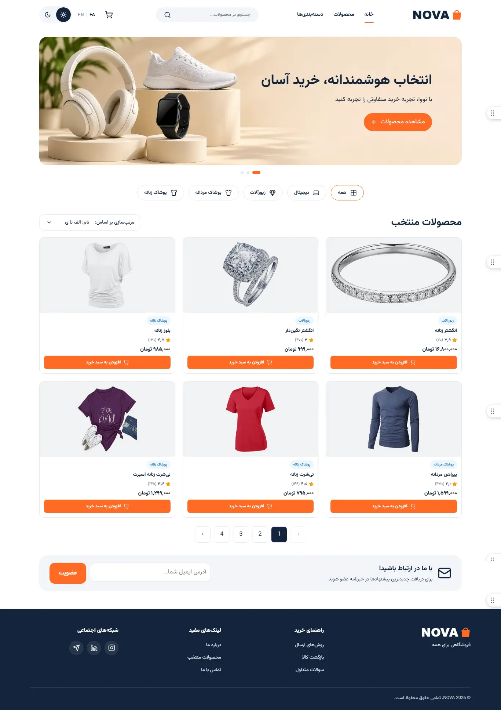
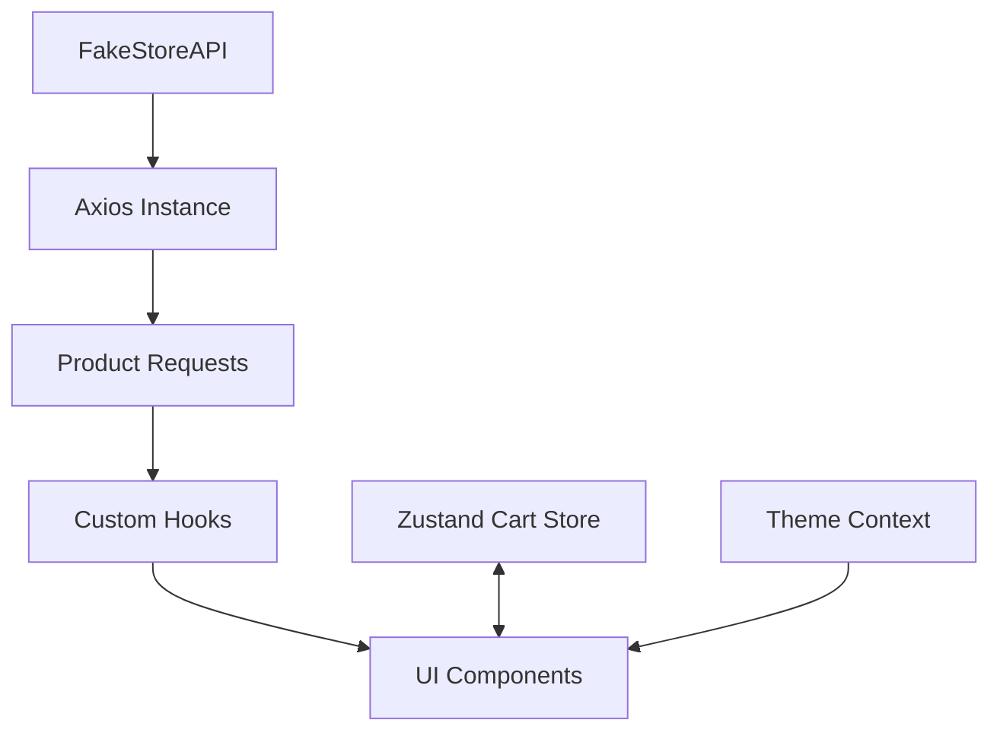

<div dir="rtl" align="right">

# 🛍️ NOVA Store | فروشگاه اینترنتی نُوا

**یک فروشگاه اینترنتی دو‌زبانه، مدرن و واکنش‌گرا؛ ساخته‌شده با Next.js 16، React و TypeScript.**

NOVA Store یک پروژه فرانت‌اند فروشگاهی است که از نمایش و مرتب‌سازی محصولات تا مدیریت سبد خرید را پوشش می‌دهد. هدف فقط ساخت چند صفحه زیبا نبوده؛ ساختاری توسعه‌پذیر، کدهای قابل نگهداری و تجربه‌ای هماهنگ در زبان‌های فارسی و انگلیسی نیز در طراحی آن اهمیت داشته است.

   

**[مشاهده کد پروژه در GitHub](https://github.com/fatemeh-abed/nova-store)** · **[راهنمای نصب و اجرا](#-اجرای-پروژه-در-چند-دقیقه)**

> این پروژه یک نمونه عملی فرانت‌اند است. پرداخت آنلاین و ثبت سفارش واقعی در آن پیاده‌سازی نشده‌اند.

## 📸 نگاهی به پروژه

### صفحه اصلی — نسخه فارسی دسکتاپ



### صفحه اصلی — نسخه موبایل


### سبد خرید — دسکتاپ و موبایل

|                           دسکتاپ                            |                          موبایل                           |
| :---------------------------------------------------------: | :-------------------------------------------------------: |
|  |  |

### حالت تاریک (Dark Mode)


> تصاویر بالا از پوشه `public/screenshots` در مخزن خوانده می‌شوند. نام فایل‌ها و پسوندهای `.webp` و `.PNG` دقیقاً مطابق فایل‌های موجود نوشته شده‌اند.

## ✨ چه امکاناتی دارد؟

- **فارسی و انگلیسی واقعی:** تغییر زبان همراه با جهت درست صفحه؛ راست‌به‌چپ برای فارسی و چپ‌به‌راست برای انگلیسی.
- **فهرست محصولات:** نمایش محصولات، دسته‌بندی، مرتب‌سازی و رابط جست‌وجو برای پیدا کردن راحت‌تر کالاها.
- **سبد خرید کاربردی:** افزودن و حذف محصول، تغییر تعداد و مشاهده خلاصه مبلغ سفارش.
- **حالت روشن و تاریک:** تغییر ظاهر فروشگاه با استفاده از یک سیستم طراحی مشترک.
- **طراحی واکنش‌گرا:** چیدمان متناسب با دسکتاپ، تبلت و موبایل، از منو تا کارت محصول و سبد خرید.
- **مدیریت وضعیت‌ها:** نمایش مناسب هنگام بارگذاری اطلاعات، خطای دریافت داده یا خالی بودن فهرست.
- **آمادگی برای موتورهای جست‌وجو:** متادیتای صفحات، Sitemap و تنظیمات Robots.
- **تسویه‌حساب نمایشی:** دکمه و رابط تسویه‌حساب برای نمایش جریان کار وجود دارد، اما پرداخت واقعی انجام نمی‌شود.

## 🧰 ابزارها و فناوری‌ها

| بخش             | فناوری                       | کاربرد در پروژه                                  |
| --------------- | ---------------------------- | ------------------------------------------------ |
| چارچوب اصلی     | Next.js 16 — App Router      | مسیرها، چیدمان صفحات و قابلیت‌های SEO            |
| رابط کاربری     | React + TypeScript           | کامپوننت‌های قابل استفاده مجدد و کدنویسی نوع‌دار |
| استایل‌دهی      | styled-components            | طراحی یکپارچه و مدیریت تم                        |
| چندزبانه‌سازی   | next-intl                    | ترجمه متن‌ها و مسیرهای فارسی و انگلیسی           |
| مدیریت سبد خرید | Zustand                      | نگهداری وضعیت محصولات انتخاب‌شده                 |
| ارتباط با API   | Axios                        | درخواست‌های شبکه با تنظیمات مشترک                |
| آیکن‌ها         | lucide-react                 | آیکن‌های هماهنگ رابط کاربری                      |
| منبع داده       | FakeStoreAPI                 | داده‌های آزمایشی محصولات                         |
| کیفیت کد        | ESLint، Prettier، TypeScript | بررسی کیفیت و خطاهای کد                          |

نسخه دقیق کتابخانه‌ها در فایل `package.json` ثبت شده است.

## 🚀 اجرای پروژه در چند دقیقه

**پیش‌نیازها:** Node.js نسخه `20.9` یا جدیدتر، npm و Git.

**۱. دریافت پروژه**

<div dir="ltr" align="left">

```bash
git clone https://github.com/fatemeh-abed/nova-store.git
cd nova-store
```

</div>

**۲. نصب وابستگی‌ها**

<div dir="ltr" align="left">

```bash
npm ci
```

</div>

**۳. ساخت فایل تنظیمات محیطی**

در Windows PowerShell:

<div dir="ltr" align="left">

```powershell
Copy-Item .env.example .env.local
```

</div>

در macOS و Linux:

<div dir="ltr" align="left">

```bash
cp .env.example .env.local
```

</div>

**۴. اجرای نسخه توسعه**

<div dir="ltr" align="left">

```bash
npm run dev
```

</div>

آدرس نمایش‌داده‌شده در ترمینال را باز کنید؛ معمولاً `http://localhost:3000` است.

| مسیر       | صفحه              |
| ---------- | ----------------- |
| `/fa`      | صفحه اصلی فارسی   |
| `/en`      | صفحه اصلی انگلیسی |
| `/fa/cart` | سبد خرید فارسی    |
| `/en/cart` | سبد خرید انگلیسی  |

### ساخت نسخه نهایی و بررسی کد

<div dir="ltr" align="left">

```bash
npx tsc --noEmit
npm run lint
npm run build
npm run start
```

</div>

## 🏗️ معماری؛ هر بخش مسئول کار خودش

برای اینکه اضافه کردن قابلیت جدید به تغییر دادن چندین فایل نامرتبط منجر نشود، پروژه به بخش‌های مشخص تقسیم شده است:

- **App Router:** تعریف مسیرهای دو‌زبانه، Layout و تنظیمات SEO.
- **Components:** ساخت رابط کاربری با اجزای مستقل برای صفحه اصلی، سبد خرید، هدر و فوتر.
- **Hooks:** جدا کردن منطق دریافت و آماده‌سازی محصولات از ظاهر صفحه.
- **API / Requests:** متمرکز کردن تنظیمات Axios و درخواست‌های مربوط به محصولات.
- **Storage:** مدیریت سبد خرید و هماهنگی وضعیت آن با محیط مرورگر.
- **Context:** مدیریت مستقل تم روشن و تاریک.
- **Utils / Types / Validations:** محاسبات و قالب‌بندی، تعریف مدل‌های TypeScript و اعتبارسنجی فرم‌ها.

### مسیر حرکت داده‌ها



<details>
<summary><strong>📁 مشاهده ساختار پوشه‌های پروژه</strong></summary>

<div dir="ltr" align="left">

```text
src/
├── api/                 # تنظیمات Axios و مدیریت خطا
├── app/                 # مسیرها، Layout، Sitemap و Robots
│   └── [locale]/        # صفحات فارسی و انگلیسی
│       └── cart/        # صفحه سبد خرید
├── assets/              # فونت‌ها، آیکن‌ها و تصاویر
├── components/          # اجزای رابط کاربری
│   ├── cart/
│   ├── home/
│   ├── layout/
│   │   ├── Footer/
│   │   └── Header/
│   └── NovaLogo/
├── context/             # مدیریت تم
├── dictionary/          # متن‌های ترجمه‌شده
├── hooks/               # منطق قابل استفاده مجدد
├── i18n/                # تنظیمات چندزبانه‌سازی
├── modals/              # پنجره‌های محاوره‌ای
├── requests/            # درخواست‌های API
├── shared/              # اجزای مشترک و توکن‌های طراحی
├── storage/             # وضعیت سبد خرید
├── types/               # تایپ‌ها و مدل‌های داده
├── utils/               # ابزارهای کمکی
├── validations/         # اعتبارسنجی
└── proxy.ts             # تنظیمات مربوط به مسیرها
```

</div>

</details>

## 🛒 سبد خرید چگونه کار می‌کند؟

برای مدیریت سبد خرید از **Zustand** استفاده شده است. هر محصول همراه با تعداد انتخاب‌شده نگهداری می‌شود و کامپوننت‌های سبد خرید می‌توانند آن را تغییر دهند.

- `src/storage/useCartStore.ts`: وضعیت و عملیات سبد خرید.
- `src/storage/useCartHydrated.ts`: هماهنگی وضعیت ذخیره‌شده با اجرای سمت مرورگر.
- `src/utils/cartTotals.ts`: محاسبه مجموع سفارش، جدا از کد نمایشی.

این جداسازی باعث می‌شود تغییر ظاهر سبد خرید، منطق محاسبه قیمت را درگیر نکند. تم نیز مستقل از سبد خرید در `ThemeContext` مدیریت می‌شود.

## 🔌 ارتباط با API

محصولات از **FakeStoreAPI** دریافت می‌شوند. برای جلوگیری از تکرار کدهای شبکه در کامپوننت‌ها، ارتباط با API در چند لایه انجام می‌شود:

| فایل                              | مسئولیت                              |
| --------------------------------- | ------------------------------------ |
| `src/api/axiosInstance.ts`        | تنظیمات مشترک درخواست‌های HTTP       |
| `src/api/apiError.ts`             | مدیریت و یکسان‌سازی خطاهای API       |
| `src/requests/productRequests.ts` | درخواست‌های مرتبط با محصولات         |
| `src/hooks/`                      | اتصال داده‌های دریافتی به منطق صفحات |

## 🧩 تصمیم‌های فنی و دلیل آن‌ها

| تصمیم                               | چرا این روش؟                                                          |
| ----------------------------------- | --------------------------------------------------------------------- |
| تفکیک API از رابط کاربری            | کامپوننت‌ها درگیر جزئیات درخواست شبکه نمی‌شوند.                       |
| استفاده از TypeScript               | ساختار داده‌ها روشن‌تر است و بخشی از خطاها پیش از اجرا مشخص می‌شود.   |
| Zustand برای سبد خرید               | وضعیت سبد خرید بدون انتقال مداوم Props بین کامپوننت‌ها مدیریت می‌شود. |
| محاسبات در `utils`                  | منطق قیمت و جمع سفارش از ظاهر صفحه جدا می‌ماند.                       |
| `next-intl` و مسیرهای `/fa` و `/en` | زبان، مسیر و جهت صفحه ساختاری مشخص و قابل توسعه دارند.                |
| توکن‌های مشترک در تم                | تغییر رنگ‌ها و ظاهر بخش‌های مختلف هماهنگ‌تر انجام می‌شود.             |

## 🌐 دو زبان، دو جهت، یک تجربه

در نسخه فارسی، متن‌ها و چیدمان راست‌به‌چپ هستند و در نسخه انگلیسی، چیدمان چپ‌به‌راست است. ترجمه‌ها و مسیرها با `next-intl` مدیریت می‌شوند.

فایل‌های اصلی:

<div dir="ltr" align="left">

```text
src/i18n/routing.ts
src/i18n/request.ts
src/i18n/navigation.ts
src/dictionary/fa.json
src/dictionary/en.json
```

</div>

## 🌗 تم روشن و تاریک

رنگ‌ها و ویژگی‌های بصری از طریق سیستم تم تعریف شده‌اند تا اجزای فروشگاه در هر دو حالت ظاهر هماهنگی داشته باشند.

<div dir="ltr" align="left">

```text
src/context/ThemeContext.tsx
src/shared/theme.ts
src/types/styled.d.ts
```

</div>

## 📱 طراحی واکنش‌گرا

چیدمان فروشگاه برای اندازه‌های مختلف صفحه طراحی شده است: منوی موبایل، کارت‌های تطبیق‌پذیر محصولات، هدر و فوتر واکنش‌گرا و نمایش مناسب سبد خرید. تصاویر بخش ابتدای README نمونه‌هایی از این صفحات را نشان می‌دهند.

## 🔎 بهینه‌سازی برای موتورهای جست‌وجو

پروژه دارای متادیتای مسیرهای چندزبانه، تولید Sitemap و تنظیمات Robots است. بسته به نوع صفحه، از قابلیت‌های رندر و تولید صفحه در Next.js نیز استفاده می‌شود.

<div dir="ltr" align="left">

```text
src/app/sitemap.ts
src/app/robots.ts
src/app/[locale]/layout.tsx
```

</div>

## ⚙️ مهندسی در دل محدودیت‌ها

FakeStoreAPI برای تمرین و نمایش قابلیت‌ها مناسب است، اما جایگزین بک‌اند واقعی فروشگاه نیست. این محدودیت‌ها در طراحی پروژه در نظر گرفته شده‌اند:

| محدودیت                                          | رویکرد پروژه                                   |
| ------------------------------------------------ | ---------------------------------------------- |
| ممکن است API کند یا موقتاً در دسترس نباشد         | نمایش وضعیت بارگذاری و خطا به‌جای صفحه نامشخص  |
| ذخیره‌سازی عملیات نوشتن قابل اتکا نیست           | فرض نکردن وجود پایگاه داده دائمی برای سفارش‌ها |
| بک‌اند واقعی سبد خرید وجود ندارد                 | مدیریت سبد خرید در سمت کاربر با Zustand        |
| موجودی و قیمت‌ها به سیستم فروش واقعی متصل نیستند | نمایش داده‌ها در چارچوب یک پروژه نمایشی        |
| درگاه پرداخت وجود ندارد                          | نمایش تسویه‌حساب صرفاً به‌صورت نمایشی           |

**نکته مهم:** قالب‌بندی فارسی قیمت‌ها و نمایش رابط کاربری به معنای وجود قیمت‌گذاری واقعی یا اتصال به سامانه پرداخت نیست.

## 🧭 اگر قرار باشد پروژه محصول واقعی شود

مراحل بعدی توسعه می‌توانند شامل اتصال به بک‌اند دائمی، احراز هویت امن، مدیریت موجودی و سفارش‌ها، اعتبارسنجی قیمت در سرور، اتصال به درگاه پرداخت و تست‌های خودکار باشند.

این موارد **نقشه راه پیشنهادی** هستند، نه امکاناتی که اکنون در پروژه پیاده‌سازی شده‌اند.

## ✅ وضعیت پروژه

طبق گزارش نسخه اولیه README:

- [x] ساختار ماژولار و استفاده از TypeScript
- [x] دو‌زبانه‌سازی فارسی و انگلیسی
- [x] پشتیبانی از تم روشن و تاریک
- [x] مدیریت سبد خرید با Zustand
- [x] دریافت محصولات با Axios
- [x] اجرای موفق بررسی TypeScript، ESLint و Build در ۱۶ نوامبر ۲۰۲۶
- [x] به‌روزرسانی مسیرهای تصاویر README به `public/screenshots`
- [x] ثبت مسیر تصاویر موبایل با پسوند `.PNG` مطابق فایل‌های معرفی‌شده
- [ ] بررسی دوباره فایل محیطی برای اطمینان از نبود اطلاعات محرمانه
- [ ] تکمیل تست دستی واکنش‌گرایی و سناریوهای API

</div>
