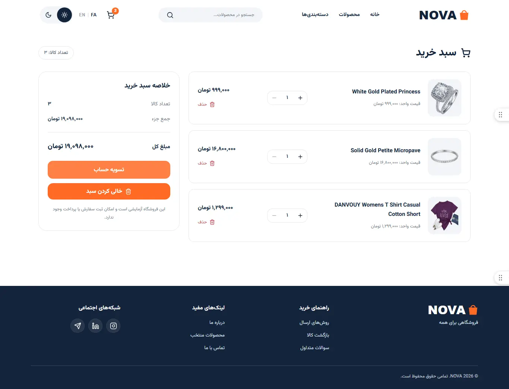
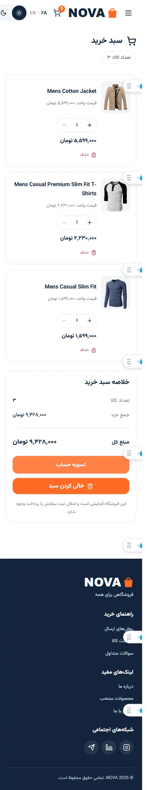

# NOVA Store

A bilingual (Persian/English) e-commerce storefront built with **Next.js 16**, **React**, **TypeScript**, and **styled-components**.

The project focuses on modular UI architecture, typed API communication, client-side cart management, localization, theming, and responsive design.

## Screenshots

### Homepage — Persian (Desktop)


### Homepage — Mobile


### Shopping Cart — Desktop & Mobile

| Desktop                                                      | Mobile                                                     |
| ------------------------------------------------------------ | ---------------------------------------------------------- |
|  |  |


## Features

- Bilingual storefront with Persian and English localization
- RTL and LTR layout support
- Responsive navigation, product cards, and cart layout
- Product catalog with categories, sorting, and search-related UI
- Shopping cart with quantity controls, item removal, and order summary
- Light and dark themes
- Reusable loading, error, and empty-state components
- SEO metadata, sitemap, and robots configuration
- Demonstration-only checkout without payment processing

## Tech Stack

| Area             | Technology                   |
| ---------------- | ---------------------------- |
| Framework        | Next.js 16 (App Router)      |
| UI               | React, TypeScript            |
| Styling          | styled-components            |
| Localization     | next-intl                    |
| State Management | Zustand                      |
| HTTP Client      | Axios                        |
| Icons            | lucide-react                 |
| Data Source      | FakeStoreAPI                 |
| Code Quality     | ESLint, Prettier, TypeScript |

Refer to `package.json` for the exact dependency versions.

## Prerequisites

- Node.js compatible with the installed Next.js version (Node.js 20.9 or newer for Next.js 16)
- npm
- Git

## Installation

Clone the repository:

```bash
git clone <https://github.com/fatemeh-abed/nova-store>
cd nova-store
```

Install dependencies:

```bash
npm ci
```

Create an environment file from `.env.example`.

Windows PowerShell:

```powershell
Copy-Item .env.example .env.local
```

macOS / Linux:

```bash
cp .env.example .env.local
```

Review the environment variables and provide the required values.

Start the development server:

```bash
npm run dev
```

Open the URL displayed in the terminal, usually `http://localhost:3000`.

Localized routes:

- `/fa` — Persian homepage
- `/en` — English homepage
- `/fa/cart` — Persian shopping cart
- `/en/cart` — English shopping cart

## Production Build

```bash
npm run build
npm run start
```

### Quality Checks

```bash
npx tsc --noEmit
npm run lint
npm run build
```

All three checks completed successfully during local testing on November 16, 2026.

## Project Structure

```text
src/
├── api/
│   ├── apiError.ts
│   └── axiosInstance.ts
├── app/
│   ├── [locale]/
│   │   ├── cart/
│   │   ├── layout.tsx
│   │   └── page.tsx
│   ├── globals.css
│   ├── robots.ts
│   └── sitemap.ts
├── assets/
│   ├── Fonts/
│   ├── Icons/
│   └── Images/
├── components/
│   ├── cart/
│   ├── home/
│   ├── layout/
│   │   ├── Footer/
│   │   └── Header/
│   └── NovaLogo/
├── context/
├── dictionary/
├── hooks/
├── i18n/
├── modals/
├── requests/
├── shared/
├── storage/
├── types/
├── utils/
├── validations/
└── proxy.ts
```

### Architecture

The project follows a modular, feature-oriented frontend architecture.

**App Router:** Defines localized routes, layouts, and SEO endpoints.

**Components:** Contains reusable presentation components organized by feature.

**Hooks:** Encapsulates reusable product-fetching and catalog logic.

**API & Requests:** Separates HTTP configuration from product request functions.

**Storage:** Manages shopping cart state and client-side hydration.

**Context:** Provides theme-related state.

**Utils:** Contains reusable formatting, product, and cart calculations.

**Types:** Defines domain models and TypeScript declarations.

**Validations:** Contains form validation logic.

## State Management

Zustand is used for shopping cart state management.

The cart implementation is located in:

```text
src/storage/useCartStore.ts
src/storage/useCartHydrated.ts
```

Cart components interact with the store to manage items and quantities.

Cart totals are calculated separately using utilities in:

```text
src/utils/cartTotals.ts
```

Theme state is handled independently through `ThemeContext`.

This separation helps keep business logic independent of presentation components.

## API Integration

Product data is retrieved from FakeStoreAPI.

The API layer is organized into:

```text
src/api/axiosInstance.ts
src/api/apiError.ts
src/requests/productRequests.ts
```

The shared Axios instance centralizes HTTP configuration.

Request functions handle product-related API operations.

Reusable hooks connect API data with the UI.

Error handling is separated from presentation components.

### Data Flow

```text
FakeStoreAPI
     |
     v
Axios Instance
     |
     v
Product Requests
     |
     v
Custom Hooks
     |
     v
UI Components
```

## FakeStoreAPI Limitations

FakeStoreAPI is intended for demonstration and testing rather than production commerce.

### Limitations

- API availability depends on an external service.
- Requests may fail or experience delays.
- Write operations should not be assumed to persist permanently.
- Product inventory and pricing are not managed by a real commerce backend.
- Cart data is managed on the client.
- No real checkout or payment processing is implemented.

### Workarounds

- Reusable loading, error, and empty states
- Centralized API error handling
- Client-side shopping cart management
- Demonstration-only checkout
- Presentation-level localization and currency formatting

A production version would require a persistent backend, authentication, validated pricing, inventory management, and payment integration.

## Localization

The application supports:

- Persian (`fa`)
- English (`en`)

Localization is implemented with `next-intl`.

Main configuration files:

```text
src/i18n/routing.ts
src/i18n/request.ts
src/i18n/navigation.ts
src/dictionary/fa.json
src/dictionary/en.json
```

Persian uses RTL layout direction, while English uses LTR.

Localized routes use explicit language prefixes.

## Theme System

The application supports light and dark themes using styled-components and a dedicated theme context.

Relevant files:

```text
src/context/ThemeContext.tsx
src/shared/theme.ts
src/types/styled.d.ts
```

The theme system centralizes reusable design values and provides consistent styling across components.

## Responsive Design

The storefront is designed to adapt to desktop, tablet, and mobile screen sizes.

Responsive behavior includes:

- Mobile navigation
- Adaptive product layouts
- Responsive header and footer
- Cart layout adjustments
- Flexible typography and spacing

Screenshots are provided to demonstrate the main responsive layouts.

## SEO

The application includes:

- Localized route metadata
- Sitemap generation
- Robots configuration
- Server-rendered and statically generated pages where supported

Relevant files:

```text
src/app/sitemap.ts
src/app/robots.ts
src/app/[locale]/layout.tsx
```

## Local Evaluation

The complete source code is available in this repository.

Reviewers can install dependencies and run the application locally using the commands above.

The main routes are:

```text
/fa
/en
/fa/cart
/en/cart
```

The repository also includes screenshots of the main desktop and responsive interfaces.

## Submission Checklist

- [x] Independent source repository
- [x] Modular project architecture
- [x] TypeScript type checking
- [x] ESLint validation
- [x] Successful production build
- [x] Bilingual implementation
- [x] Theme support
- [x] Shopping cart state management
- [x] Axios-based API integration
- [x] Meaningful Git commit history
- [ ] Verify screenshot paths
- [ ] Verify environment example contains no secrets
- [ ] Complete manual responsive and API testing

## Project Scope

NOVA Store is a frontend demonstration project created to demonstrate modern React and Next.js development practices.

It does not include a production-ready payment gateway, persistent order management, or a full commerce backend.
